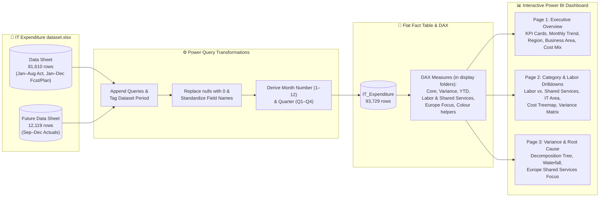
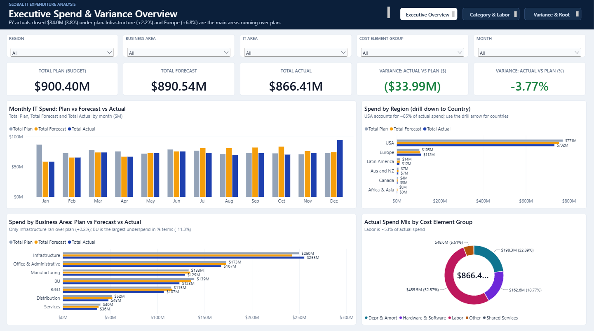
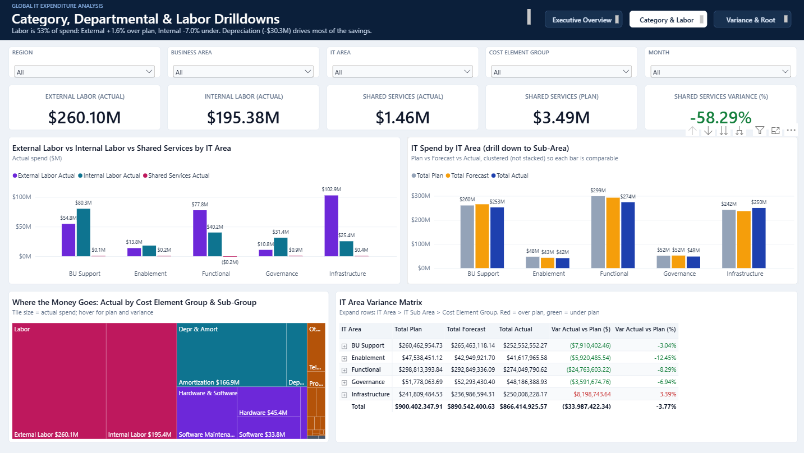
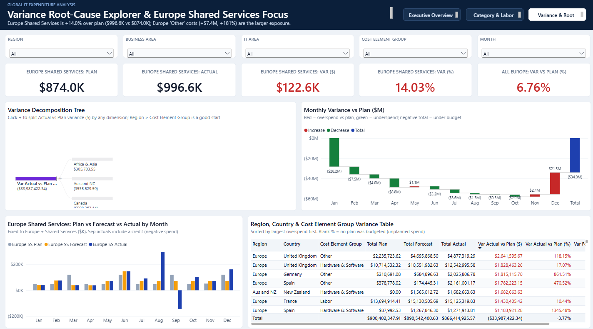

<div align="center">

# 💻 Global IT Expenditure Analysis (Power BI)

### Analyzing Actual vs. Forecast vs. Planned IT Spend across Business Areas, Geographies, and Cost Elements


-blue)


</div>

---

## 📑 Table of Contents

1. [Project Overview & Problem Framing](#-project-overview--problem-framing)
2. [Headline Numbers (Full-Year vs. YTD)](#-headline-numbers-full-year-vs-ytd)
3. [Dataset Structure & Data Preparation](#-dataset-structure--data-preparation)
4. [Power BI Architecture & Analytical Workflow](#-power-bi-architecture--analytical-workflow)
5. [Dashboard Pages & Design](#-dashboard-pages--design)
6. [Key Exploratory & Analytical Findings](#-key-exploratory--analytical-findings)
7. [Strategic Recommendations](#-strategic-recommendations)
8. [Data Quality & Governance Flags](#-data-quality--governance-flags)
9. [Repository Contents](#-repository-contents)
10. [Author](#-author)

---

## 🎯 Project Overview & Problem Framing

**Core Business Question:**

> *How can the organization monitor, govern, and optimize global IT expenditures across business units, geographic regions, and cost categories to prevent budget overruns and improve forecast accuracy?*

In a large multinational enterprise managing **~$900M in annual IT expenditure**, finance and IT leaders must balance operational stability against strict budget accountability. This project transforms raw general-ledger cost center exports into an interactive **Power BI Executive Dashboard** that answers three critical questions:

| # | Analytical Pillar | Core Question Answered |
| :-: | :--- | :--- |
| **1** | **Cost Distribution** | How is IT spend distributed across **7 Business Areas**, **5 IT Areas (38 Sub-Areas)**, **6 Regions (30 Countries)**, and **5 Cost Element Groups (23 Sub-Groups)**? |
| **2** | **Budget & Forecast Alignment** | Where are the largest variances between **Actual**, **Forecast**, and **Planned** IT spend over time and across geographies? |
| **3** | **Structural Cost Drivers** | What drives cost deviations within key operational areas such as **Internal vs. External Labor**, **Shared Services**, and **R&D Planning**? |

---

## 📊 Headline Numbers (Full-Year vs. YTD)

The source Excel workbook ([`IT Expenditure dataset.xlsx`](IT%20Expenditure%20dataset.xlsx)) contains two sheets: **`Data`** (`81,610` rows: Jan–Aug Actuals + Jan–Dec Forecast & Plan) and **`Future Data`** (`12,119` rows: Sep–Dec Actuals). Both views are summarized below:

### A. Full-Year Combined View (`Data` + `Future Data`, Jan–Dec — 93,729 Rows)
| 📋 Total Plan (Budget) | 🔮 Total Forecast | 💰 Total Actual | 📉 Actual vs. Plan Variance | 📊 Forecast vs. Plan Variance |
| :---: | :---: | :---: | :---: | :---: |
| **`$900.40M`**<br>*(`$900,402,348`)* | **`$890.54M`**<br>*(`$890,542,401`)* | **`$866.41M`**<br>*(`$866,414,926`)* | **`-$33.99M` (`-3.77%`)**<br>*(Favorable / Under Budget)* | **`-$9.86M` (`-1.10%`)**<br>*(Under Budget)* |

### B. Initial `Data` Sheet Only View (Jan–Aug Actuals — 81,610 Rows)
| Metric Scope | 📋 Plan | 🔮 Forecast | 💰 Actual (Jan–Aug) | 📉 Actual vs. Plan | 📊 Actual vs. Forecast |
| :--- | :---: | :---: | :---: | :---: | :---: |
| **YTD Apples-to-Apples (`Jan–Aug`)** | `$611.31M` | `$574.82M` | **`$555.73M`** | **`-$55.57M` (`-9.09%`)** | **`-$19.09M` (`-3.32%`)** |
| **Unadjusted `Data` Sheet (`Jan–Dec` Plan/Fcst)** | `$900.40M` | `$890.54M` | **`$555.73M`** | `-$344.67M` (`-38.28%` / `61.7%` utilized) | `-$334.81M` (`-37.60%`) |

> **Variance Sign Convention:** Throughout this report, `Variance = Actual − Plan`. A **negative (`−`) variance** indicates **underspend / cost savings** (favorable to budget), while a **positive (`+`) variance** indicates **overspend / budget overrun** (unfavorable).

---

## 🗂 Dataset Structure & Data Preparation

| Property | Detail |
| :--- | :--- |
| **Source File** | [`IT Expenditure dataset.xlsx`](IT%20Expenditure%20dataset.xlsx) |
| **Sheet 1: `Data`** | `81,610` rows × `12` columns (`Jan–Aug` Actuals: `22,884` rows; `Jan–Dec` Forecast: `31,691` rows; `Jan–Dec` Plan: `27,035` rows) |
| **Sheet 2: `Future Data`** | `12,119` rows × `10` columns (`Sep–Dec` Actuals only; adds 7 new countries to the 23 in `Data` for `30` total countries) |
| **Dimensions** | **7** Business Areas · **6** Regions · **30** Countries · **5** IT Areas · **38** IT Sub-Areas · **5** Cost Element Groups · **23** Cost Element Sub-Groups · **205** Cost Element Names |

### Data Cleaning & Transformation Pipeline in Power Query
| Step | Action Taken in Power BI (Power Query) | Analytical Justification |
| :--- | :--- | :--- |
| **1. Append & Tag Sheets** | Added `Dataset Period` (`"Jan-Aug (Initial Data)"` vs. `"Sep-Dec (Future Actuals)"`) and appended `Future Data` to `Data` (`93,729` total rows). | Completes the 12-month Actuals series while preserving the ability to filter to the original `Data` sheet (`Jan–Aug`) with a single click. |
| **2. Standardize Headers** | Renamed `Date` → `Month`, `Cost element name` → `Cost Element Name`, and standardized currency formatting (`$#,##0`). | Ensures consistent Pascal/Title Case naming across all visuals, tooltips, and DAX formulas. |
| **3. Handle Blank / `null` Values** | Replaced `null` with `0` across `Actual` (`58,726` nulls in `Data`), `Forecast` (`49,919` nulls), and `Plan` (`54,575` nulls). | Each row in the ERP export populates only *one* measure (`Actual`, `Forecast`, or `Plan`). Dropping rows with nulls would erase the budget; replacing with `0` enables safe row-level arithmetic. |
| **4. Chronological Month Sorting** | Derived `Month Number` (`1` to `12`) and `Quarter` (`Q1` to `Q4`), and configured **Sort by Column** (`Month` sorted by `Month Number`). | Prevents Power BI from sorting text months alphabetically (`Apr, Aug, Dec...`). |
| **5. Preserve Accounting Credits** | Retained `1,463` negative Actual rows (`-$126.33M` in `Data`) and `310` negative Plan rows (`-$10.19M`). | Negative rows represent valid outbound shared-service allocations, chargebacks, and accrual reversals; removing them would inflate net IT expenditure. |

> **Model note:** The standardized names (`Month`, `Cost Element Name`) are applied by a final `Table.RenameColumns` step in the `IT_Expenditure` query. The `Future_Data` table is a hidden, unused staging copy; all reporting reads from the combined `IT_Expenditure` table. The `Dataset Period` column is still in the model, but it is no longer exposed as a slicer. Filtering to `Jan-Aug (Initial Data)` shows a full-year Plan beside only 8 months of Actuals, so use the **Month** slicer (`Jan`–`Aug`) for a fair YTD comparison.

---

## 🧭 Power BI Architecture & Analytical Workflow



---

## 🖥️ Dashboard Pages & Design

The dashboard is delivered as a single Power BI file, [`IT_Expenditure_Analysis.pbix`](IT_Expenditure_Analysis.pbix), built from [`IT Expenditure dataset.xlsx`](IT%20Expenditure%20dataset.xlsx). It has **3 pages** at `1920 × 1080` (Fit to Page) that share one custom theme (`IT Spend Executive`).

### 🚀 How to Open It
1. Download both `IT_Expenditure_Analysis.pbix` and `IT Expenditure dataset.xlsx` and open the `.pbix` in **Power BI Desktop** (free, Windows).
2. The data is already stored inside the `.pbix`, so the report opens and works as-is.
3. To refresh from the Excel file, first point the report at your copy of it: **Home → Transform data → Data source settings → Change Source…** (the saved path is the author's local folder).
4. For a presentation, switch to **Reading view** (bottom-left book icon) and use the three navigation buttons in the top-right of the banner.

### 🖼️ Dashboard Preview
| Page 1: Executive Overview | Page 2: Category & Labor Drilldowns | Page 3: Variance & Root Cause |
| :---: | :---: | :---: |
|  |  |  |

### Shared layout (all pages)
| Element | Description |
| :--- | :--- |
| **Header banner** | Navy banner with the page title and a one-line takeaway. The takeaways are typed text, so they describe the unfiltered full-year view. |
| **Page navigation** | Three buttons in the top-right of the banner (`Executive Overview`, `Category & Labor`, `Variance & Root Cause`); the current page is highlighted white. Use `Ctrl+Click` in the editor, plain click in Reading view. |
| **Filter bar** | Five dropdown slicers: `Region`, `Business Area`, `IT Area`, `Cost Element Group`, `Month`. They are **synced across all pages**. |
| **Colour logic** | Plan = grey, Forecast = amber, Actual = blue on every chart. Variance shows **red = over plan** and **green = under plan**. |

### Page 1: Executive Overview
| Visual | Purpose |
| :--- | :--- |
| 5 KPI cards | Total Plan, Total Forecast, Total Actual, Var ($), Var (%). The two variance cards change colour with the sign. |
| Monthly clustered columns | Plan vs. Forecast vs. Actual by month, on one axis so heights compare honestly. |
| Region bar (drill to Country) | Spend by region, sorted by Actual, with data labels. |
| Business Area bar | Plan vs. Forecast vs. Actual, sorted by Actual. |
| Cost Element Group donut | Share of actual spend; tooltip shows Plan and Var (%). |

### Page 2: Category & Labor Drilldowns
| Visual | Purpose |
| :--- | :--- |
| 5 KPI cards | External Labor, Internal Labor, Shared Services (Actual and Plan) and Shared Services Var (%). |
| Labor vs. Shared Services by IT Area | Clustered columns comparing the three actuals. |
| IT Area / Sub-Area columns | Plan vs. Forecast vs. Actual, clustered, with drill to IT Sub Area. |
| Treemap | Actual spend by Cost Element Group and Sub-Group; tooltip shows Plan and variance. |
| Variance matrix | IT Area → IT Sub Area → Cost Element Group with red/green variance columns. |

### Page 3: Variance & Root Cause
| Visual | Purpose |
| :--- | :--- |
| 5 Europe KPI cards | Europe Shared Services Plan, Actual, Var ($), Var (%), and all-Europe Var (%). These measures are fixed to Europe, so they ignore the Region slicer. |
| Decomposition tree | Splits Actual vs. Plan variance by Region, Cost Element Group, IT Area, Business Area and more. |
| Variance waterfall | Monthly variance vs. Plan, with overspend in red and underspend in green. |
| Europe Shared Services by month | Plan vs. Forecast vs. Actual, fixed to Europe and Shared Services. |
| Detail table | Region, Country and Cost Element Group variances, sorted by largest overspend first. A blank % means no Plan was budgeted. |

### Design decisions
- **Clustered, not stacked:** Plan, Forecast and Actual are three versions of the same spend, so they are never stacked.
- **Waterfall colours:** increases are red and decreases green because this is cost, not revenue.
- **Treemap added** to cover the brief's tree-map / pie-chart requirement alongside the donut.
- **Europe Shared Services:** it is `+14.0%` over plan (`$996.6K` vs. `$874.0K`). It is over plan in 8 of 12 months, with an August spike and a September credit, so it is a recurring overspend but not a steady one.

---

## 🔍 Key Exploratory & Analytical Findings

### 1️⃣ Monthly Trends: The Q1 Slow Start, Q3 Forecast Inflation & December Spend Surge

| Month | Actual (`$M`) | Forecast (`$M`) | Plan (`$M`) | Actual vs. Plan (`$M`) | Actual vs. Plan (`%`) | Forecast vs. Plan (`%`) | Actual vs. Forecast (`%`) |
| :---: | :---: | :---: | :---: | :---: | :---: | :---: | :---: |
| **Jan** | `$58.46M` | `$58.46M` | `$86.71M` | **`-$28.25M`** | 🟢 **`-32.58%`** | `-32.58%` | `0.00%` |
| **Feb** | `$65.35M` | `$65.35M` | `$72.90M` | `-$7.54M` | 🟢 `-10.35%` | `-10.35%` | `0.00%` |
| **Mar** | `$73.79M` | `$73.79M` | `$77.82M` | `-$4.03M` | 🟢 `-5.18%` | `-5.18%` | `0.00%` |
| **Apr** | `$66.73M` | `$66.73M` | `$75.50M` | `-$8.76M` | 🟢 `-11.61%` | `-11.61%` | `0.00%` |
| **May** | `$72.85M` | `$72.85M` | `$71.77M` | `+$1.08M` | 🔴 `+1.51%` | `+1.51%` | `0.00%` |
| **Jun** | `$75.50M` | `$75.50M` | `$78.70M` | `-$3.20M` | 🟢 `-4.07%` | `-4.07%` | `0.00%` |
| **Jul** | `$73.21M` | `$81.08M` | `$76.79M` | `-$3.58M` | 🟢 `-4.66%` | 🔴 `+5.60%` | 🟢 `-9.71%` |
| **Aug** | `$69.83M` | `$81.04M` | `$71.12M` | `-$1.29M` | 🟢 `-1.82%` | 🔴 `+13.95%` | 🟢 `-13.83%` |
| *YTD (Jan–Aug)* | *`$555.73M`* | *`$574.82M`* | *`$611.31M`* | *`-$55.57M`* | *🟢 `-9.09%`* | *`-5.97%`* | *`-3.32%`* |
| **Sep** *(Future)* | `$72.79M` | `$81.94M` | `$73.10M` | `-$0.31M` | 🟢 `-0.43%` | 🔴 `+12.09%` | 🟢 `-11.16%` |
| **Oct** *(Future)* | `$70.24M` | `$83.50M` | `$72.28M` | `-$2.04M` | 🟢 `-2.83%` | 🔴 `+15.52%` | 🟢 `-15.88%` |
| **Nov** *(Future)* | `$73.09M` | `$76.05M` | `$70.67M` | `+$2.43M` | 🔴 `+3.43%` | 🔴 `+7.61%` | 🟢 `-3.88%` |
| **Dec** *(Future)* | **`$94.56M`** 🔥 | `$74.23M` | `$73.04M` | **`+$21.52M`** | 🔴 **`+29.46%`** | `+1.63%` | 🔴 **`+27.38%`** |
| **Full Year** | **`$866.41M`** | **`$890.54M`** | **`$900.40M`** | **`-$33.99M`** | 🟢 **`-3.77%`** | **`-1.10%`** | **`-2.71%`** |

- **H1 Forecast Lock (`Jan–Jun`):** `Actual` and `Forecast` are identical (`$412.69M`) from January through June because H1 accounting books were closed when the mid-year re-forecast was generated.
- **January Bottleneck (`-$28.25M` / `-32.58%`):** Over **83%** of the entire full-year net savings (`-$28.25M` out of `-$33.99M`) occurred in January due to delayed project ramp-ups and vendor onboarding.
- **Q3/Q4 Forecast Bias (`Jul–Oct`):** Department leads forecasted an aggressive `$81.0M–$83.5M/month` burn rate (`+5.6%` to `+15.5%` above Plan), but actual spend remained steady around `$70M–$73M/month` (`-9.7%` to `-15.9%` below Forecast).
- **December Year-End Surge (`+$21.52M` / `+29.46%` vs. Plan):** December Actuals jump to **`$94.56M`** (`31%` higher than the Jan–Nov monthly average of `$70.17M`), driven by year-end software license purchases, telecom true-ups, and discretionary project spend.

---

### 2️⃣ Regional & Country Analysis: USA Saves while Europe Overspends

| Region | Full-Year Actual | Full-Year Forecast | Full-Year Plan | Plan Share | Actual vs. Plan (`$`) | Actual vs. Plan (`%`) | YTD (Jan–Aug) Actual vs. Plan (`%`) |
| :--- | :---: | :---: | :---: | :---: | :---: | :---: | :---: |
| **USA** | `$732.39M` | `$754.03M` | `$770.93M` | `85.62%` | `-$38.54M` | 🟢 **`-5.00%`** | `-10.13%` (`$470.86M` vs. `$523.94M`) |
| **Europe** | **`$111.73M`** | **`$108.45M`** | **`$104.66M`** | `11.62%` | **`+$7.07M`** | 🔴 **`+6.76%`** | `-0.17%` (`$70.69M` vs. `$70.80M`) |
| **Latin America** | `$11.84M` | `$13.55M` | `$13.62M` | `1.51%` | `-$1.78M` | 🟢 `-13.07%` | `-16.37%` (`$7.61M` vs. `$9.11M`) |
| **Aus and NZ** | `$6.79M` | `$7.52M` | `$7.32M` | `0.81%` | `-$0.54M` | 🟢 `-7.32%` | `-10.43%` (`$4.37M` vs. `$4.88M`) |
| **Canada** | `$3.36M` | `$3.87M` | `$3.87M` | `0.43%` | `-$0.51M` | 🟢 `-13.15%` | `-16.15%` (`$2.16M` vs. `$2.58M`) |
| **Africa & Asia** | `$0.31M` | `$3.12M` | **`$0.00M`** | `0.00%` | **`+$0.31M`** | ⚠️ **Unbudgeted** | `+$37.6K` Actual / `+$816.5K` YTD Fcst |

#### Deep Dive: Why Does Europe Overspend by `+$7.07M` (`+6.76%`)?
1. **Shared Services in Europe (`+14.03%` Full-Year / `+50.65%` YTD Overspend vs. Plan):**
   - Full-year European Shared Services Actual is **`$996,558` vs. `$873,974` Plan (`+$122,583` or `+14.03%` overspend)**—and in the initial `Data` sheet (**YTD Jan–Aug**), it is **`$802,306` vs. `$532,573` Plan (`+50.65%` overspend)**!
   - Out of 12 months, European Shared Services exceeded budget in **8 months** (including `+53.3%` in Feb, `+46.4%` in May, `+87.9%` in Jul, `+524.0%` in Aug, `+109.8%` in Oct, `+37.7%` in Nov, and `+34.9%` in Dec), driven by higher `Outbound Allocations` (`$690.8K` Actual vs. `$485.7K` Plan, **`+42.2%`**).
2. **Hardware & Software in Europe (`+14.25%` / `+$2.93M` Overspend):**
   - Reached **`$23.48M` Actual vs. `$20.55M` Plan**, driven by unbudgeted Q4 hardware refreshes and software licensing in the UK and Germany.
3. **Other Expenses in Europe (`+180.98%` / `+$7.37M` Overspend):**
   - Surged to **`$11.44M` Actual vs. `$4.07M` Plan**, led by European telecom and project expenses.
4. **Country-Level Drivers in Europe:**
   - 🔴 **Top Overspending Countries:** **Germany** (`+$3.08M` / `+33.54%`), **United Kingdom** (`+$2.82M` / `+6.80%`), **Spain** (`+$2.67M` / `+54.01%`), **Switzerland** (`+$1.28M` / `+55.80%`), and **Belgium** (`+$0.90M` / `+13.05%`).
   - 🟢 **Under-Budget European Countries:** **Italy** (`-$2.05M` / `-21.25%`), **France** (`-$1.54M` / `-7.48%`), and **Ireland** (`-$1.25M` / `-17.44%`).

---

### 3️⃣ IT Area & Business Area Breakdown: `Infrastructure` Overspends while `Functional` & `BU` Save

#### By IT Area
| IT Area | Full-Year Actual | Full-Year Forecast | Full-Year Plan | Actual Share | Actual vs. Plan (`$`) | Actual vs. Plan (`%`) | YTD (Jan–Aug) Actual vs. Plan (`%`) |
| :--- | :---: | :---: | :---: | :---: | :---: | :---: | :---: |
| **Functional** | `$274.05M` | `$292.85M` | `$298.81M` | `31.63%` | `-$24.76M` | 🟢 `-8.29%` | `-10.85%` (`$178.43M` vs. `$200.13M`) |
| **BU Support** | `$252.55M` | `$265.46M` | `$260.46M` | `29.15%` | `-$7.91M` | 🟢 `-3.04%` | `-9.57%` (`$164.19M` vs. `$181.57M`) |
| **Infrastructure** | **`$250.01M`** | `$236.99M` | **`$241.81M`** | `28.86%` | **`+$8.20M`** | 🔴 **`+3.39%`** | `-5.94%` (`$154.90M` vs. `$164.68M`) |
| **Governance** | `$48.19M` | `$52.29M` | `$51.78M` | `5.56%` | `-$3.59M` | 🟢 `-6.94%` | `-1.90%` (`$32.88M` vs. `$33.52M`) |
| **Enablement** | `$41.62M` | `$42.95M` | `$47.54M` | `4.80%` | `-$5.92M` | 🟢 `-12.45%` | `-19.31%` (`$25.34M` vs. `$31.41M`) |

#### By Business Area
| Business Area | Full-Year Actual | Full-Year Forecast | Full-Year Plan | Actual Share | Actual vs. Plan (`$`) | Actual vs. Plan (`%`) | YTD (Jan–Aug) Actual vs. Plan (`%`) |
| :--- | :---: | :---: | :---: | :---: | :---: | :---: | :---: |
| **Infrastructure** | **`$255.34M`** | `$242.18M` | **`$249.76M`** | `29.47%` | **`+$5.57M`** | 🔴 **`+2.23%`** | `-7.01%` (`$157.81M` vs. `$169.71M`) |
| **Office & Admin** | `$167.39M` | `$172.48M` | `$172.81M` | `19.32%` | `-$5.43M` | 🟢 `-3.14%` | `-3.88%` (`$111.23M` vs. `$115.72M`) |
| **Manufacturing** | `$129.07M` | `$134.65M` | `$132.99M` | `14.90%` | `-$3.92M` | 🟢 `-2.94%` | `-1.45%` (`$87.63M` vs. `$88.92M`) |
| **BU** | `$123.27M` | `$135.39M` | `$138.92M` | `14.23%` | `-$15.65M` | 🟢 **`-11.27%`** | `-16.58%` (`$77.58M` vs. `$93.00M`) |
| **R&D** | `$106.83M` | `$115.80M` | `$114.56M` | `12.33%` | `-$7.74M` | 🟢 `-6.75%` | `-21.30%` (`$66.16M` vs. `$84.07M`) |
| **Distribution** | `$48.17M` | `$52.29M` | `$51.78M` | `5.56%` | `-$3.61M` | 🟢 `-6.98%` | `-1.90%` (`$32.88M` vs. `$33.52M`) |
| **Services** | `$36.36M` | `$37.75M` | `$39.58M` | `4.20%` | `-$3.22M` | 🟢 `-8.14%` | `-14.93%` (`$22.44M` vs. `$26.38M`) |

---

### 4️⃣ Cost Drivers: Internal Labor vs. External Labor, Shared Services & `Planning`

| Cost Element Group | Full-Year Actual | Full-Year Forecast | Full-Year Plan | Actual Share | Actual vs. Plan (`$`) | Actual vs. Plan (`%`) | Top Cost Element Sub-Groups (Full-Year Actual) |
| :--- | :---: | :---: | :---: | :---: | :---: | :---: | :--- |
| **Labor** | **`$455.48M`** | `$474.37M` | `$466.17M` | **`52.57%`** | `-$10.69M` | 🟢 `-2.29%` | `External Labor` (`$260.10M`), `Internal Labor` (`$195.38M`) |
| **Depr & Amort** | **`$198.29M`** | `$205.52M` | `$218.31M` | **`22.89%`** | `-$20.02M` | 🟢 `-9.17%` | `Amortization` (`$166.88M`, `+6.58%`), `Depreciation` (`$31.40M`, `-49.12%`) |
| **Hardware & Software** | **`$162.60M`** | `$155.50M` | `$164.43M` | **`18.77%`** | `-$1.84M` | 🟢 `-1.12%` | `Software Maint.` (`$75.25M`), `Hardware` (`$45.41M`), `Software` (`$33.77M`, **`+50.44%`**) |
| **Other** | **`$48.59M`** | `$53.38M` | `$47.99M` | **`5.61%`** | `+$0.60M` | 🔴 **`+1.25%`** | `Telecomm` (`$20.85M`, **`+120.96%`**), `Project Exp.` (`$7.08M`, **`+302.48%`**), `Travel` (`$6.23M`, **`+37.97%`**) |
| **Shared Services** | **`$1.46M`** | `$1.78M` | `$3.49M` | **`0.17%`** | `-$2.04M` | 🟢 `-58.29%` | `Outbound Allocations` (`$907.7K`), `Inbound Allocations` (`$549.3K`) |

#### Key Cost-Driver Insights:
1. **External Labor Over-Reliance (`$260.10M` vs. `$195.38M` Internal Labor):**
   - **External Labor** makes up **`30.02%` of total IT spend** (`57.1%` of all Labor) and **overspends Plan by `+$4.10M` (`+1.60%`)** (while Forecast overspends Plan by **`+$13.39M` / `+5.23%`**).
   - Meanwhile, **Internal Labor** (`$195.38M`) is **`-$14.78M` (`-7.04%`) under Plan**, showing that open FTE positions were backfilled with higher-cost contractors.
   - In **`Infrastructure`**, External Labor (`$102.88M`) is **4.05×** Internal Labor (`$25.41M`). In **`Functional`**, External Labor (`$77.80M`) is **1.94×** Internal Labor (`$40.17M`).
2. **Internal Labor vs. Shared Services Cost Patterns:**
   - **Internal Labor** behaves as a predictable fixed monthly base (`~$16.3M/month` across `BU Support` `$80.3M`, `Functional` `$40.2M`, and `Governance` `$31.4M`).
   - **Shared Services** (`Inbound` + `Outbound Allocations`) is highly volatile and asymmetric: it is heavily under-utilized in `BU Support` (`-94.8%` vs. Plan, `$114.3K` vs. `$2.20M`), negative in `Functional` (`-$224.2K` due to `-$337.5K` outbound chargeback credits), and over-utilized in `Enablement` (`+286.8%`), `Infrastructure` (`+125.4%`), and **Europe (`+14.03%` Full-Year / `+50.65%` YTD)**.
3. **Inside the `Planning` IT Sub-Area (`$73.84M` Full-Year / `$48.50M` YTD):**
   - `Planning` is the **#3 IT Sub-Area overall** (`8.52%` of total IT spend) and sits under **`IT Area = BU Support`** and **`Business Area = R&D`**.
   - While top-line `Planning` spend appears aligned with budget (`$73.84M` Actual vs. `$74.57M` Plan = `-0.98%`), drilling into Cost Elements reveals that **`Planning` Labor overspent Plan by `+$4.99M` (`+16.26%`, `$35.67M` Actual vs. `$30.68M` Plan)**, masked by a `-$2.92M` (`-10.87%`) underspend in `Hardware & Software` and `-$1.93M` in `Shared Services` credit offsets (`-$300.8K` Actual vs. `$1.63M` Plan).

---

## 💡 Strategic Recommendations

| # | Target Area | Actionable Recommendation | Quantified Financial Impact |
| :-: | :--- | :--- | :--- |
| **1** | **Europe Regional Spend (`Shared Services`, `H&S`, `Telecomm`)** | Audit European cost centers—specifically **Germany (`+$3.08M`)**, **UK (`+$2.82M`)**, **Spain (`+$2.67M`)**, and **Switzerland (`+$1.28M`)**—and renegotiate telecom (`+181%` Other) and outbound shared-service allocations (`+14.0%` Full-Year / `+50.6%` YTD). | Bring Europe back within its `$104.66M` baseline plan, recovering **`$7.07M`** in regional overruns. |
| **2** | **External vs. Internal Labor Mix (`Infrastructure` & `Functional`)** | Convert long-tenure contractor roles (`$260.10M` External Labor) into permanent internal FTEs (`-$14.78M` unused Internal Labor budget), prioritizing **`Infrastructure` (4:1 contractor ratio)** and **`R&D Planning` (`+$4.99M` labor overrun)**. | Eliminates the **`+$4.10M` (`+$13.39M` forecasted)** external labor overrun and saves **15–25%** on unit labor rates. |
| **3** | **Q4 Spend Controls & Software/Telecom Governance** | Institute mandatory CFO/CIO sign-off for Q4 discretionary purchases to curb the **December spend surge (`$94.56M`, `+$21.52M` over Plan)** driven by `Project Expenses` (`+302.5%`), `Telecomm` (`+121.0%`), and `Software` (`+50.4%`). | Prevents **`~$20M+`** in year-end "use-it-or-lose-it" budget spikes. |
| **4** | **Mid-Year Forecast Calibration (`Jul–Oct`)** | Replace static mid-year departmental re-forecasts with rolling 3-month driver-based forecasting to eliminate the **`$9M–$13M/month` Q3 forecast inflation** observed between July and October. | Improves enterprise forecast accuracy from `-10%..16%` monthly error to within **`±3%`**. |
| **5** | **Shadow Spend Governance (`Africa & Asia` & `Legal`)** | Enforce ERP budget locks so cost centers in **`Africa & Asia`** (`$3.12M` Forecast, `$305.7K` Actual on `$0` Plan) and **`Legal` / `Licensing`** (`$162.2K` Actual on `$0` Plan) cannot book expenses without an approved baseline `Plan`. | Closes **`$3.4M+`** in unbudgeted governance gaps. |

---

## ⚠️ Data Quality & Governance Flags

These structural characteristics were verified during EDA and handled in Power Query:

1. **Split Fact Tables (`Data` vs. `Future Data`):** `Data` contains `Actual` values only for `Jan–Aug` (`$555.73M`) and `null` for `Sep–Dec`, while `Future Data` holds `Sep–Dec` `Actual` values (`$310.68M`) and introduces **7 new countries** (`Poland`, `Norway`, `South Africa`, `Denmark`, `Finland`, `Sweden`, `Slovenia`, `Portugal`, `Romania` vs. `China`/`Japan` which have Forecast only).
2. **Single-Metric Row Structure:** In `Data` (`81,610` rows), no row contains more than one metric (`22,884` Actual-only rows, `31,691` Forecast-only rows, `27,035` Plan-only rows). Filtering out `null` in any single measure column will delete the other two measures.
3. **Accounting Credits / Negative Spend Rows:** `Data` contains `1,463` negative Actual rows (`-$126.33M`), `3,027` negative Forecast rows (`-$145.67M`), and `310` negative Plan rows (`-$10.19M`), representing valid internal credits and chargeback allocations.
4. **Identical H1 Actual & Forecast (`Jan–Jun`):** From January to June, `Forecast` is an exact copy of `Actual` (`$412,693,800.60`), confirming the dataset represents a mid-year (`June Close`) re-forecast snapshot.

---

## 📁 Repository Contents

```
it-expenditure-analysis-powerbi/
├── 📄 README.md                                  ← Project report (You are here)
├── 📊 IT_Expenditure_Analysis.pbix               ← Power BI report (3 pages, data model & DAX measures)
├── 📗 IT Expenditure dataset.xlsx                ← Source Dataset (Data: 81,610 rows + Future Data: 12,119 rows)
└── 📂 screenshots/                               ← Dashboard page previews used in this README
    ├── 01_executive_overview.png
    ├── 02_category_labor.png
    └── 03_variance_root_cause.png
```

---

## 👤 Author

**Anuj Nagar**  
Crio Data Analytics (`DA-201`) · Session 7 Project — IT Expenditure Analysis

